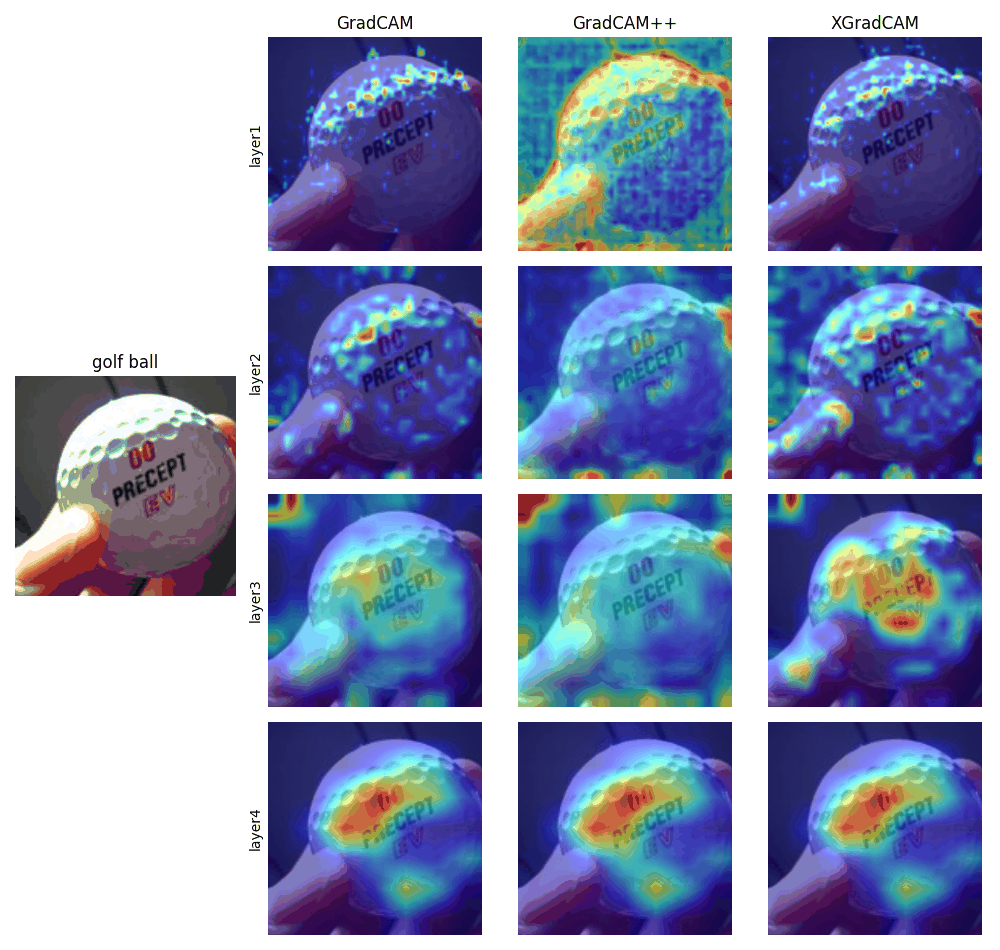
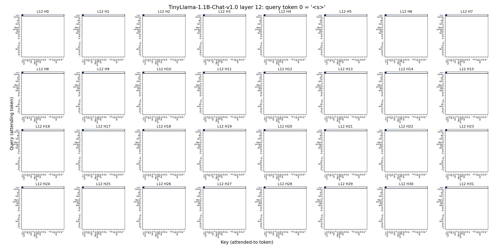
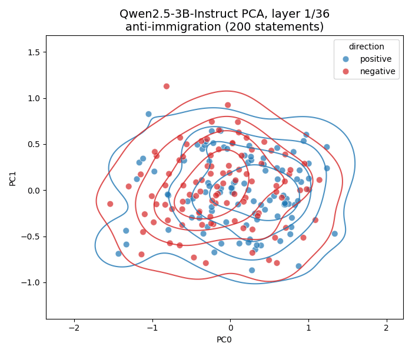

# representaciones_primavera_dl

Snippets para visualizar distintas formas de analizar modelos de deep learning:

- **Grad-CAM** sobre una ResNet-50 (imagenes)
- **Cabezas de atención** de TinyLlama con TransformerLens (lenguaje)
- **Representaciones internas** de Qwen2.5-3B proyectados con PCA (lenguaje)

## Setup

El proyecto usa [uv](https://docs.astral.sh/uv/) y Python >= 3.10 (ver `.python-version`).

1. Desde la base del repo:

   ```bash
   uv sync
   ```

## Ejemplos

### Grad-CAM: [`examples/gradcam_example.py`](examples/gradcam_example.py)

```bash
uv run python examples/gradcam_example.py
```



### Cabezas de atención: [`examples/attention_example.py`](examples/attention_example.py)

Carga TinyLlama con TransformerLens.

```bash
uv run python examples/attention_example.py
```




### Representaciones internas: [`examples/hidden_example.py`](examples/hidden_example.py)

Extrae la representación interna del último token de Qwen2.5-3B-Instruct.

```bash
uv run python examples/hidden_example.py
```



